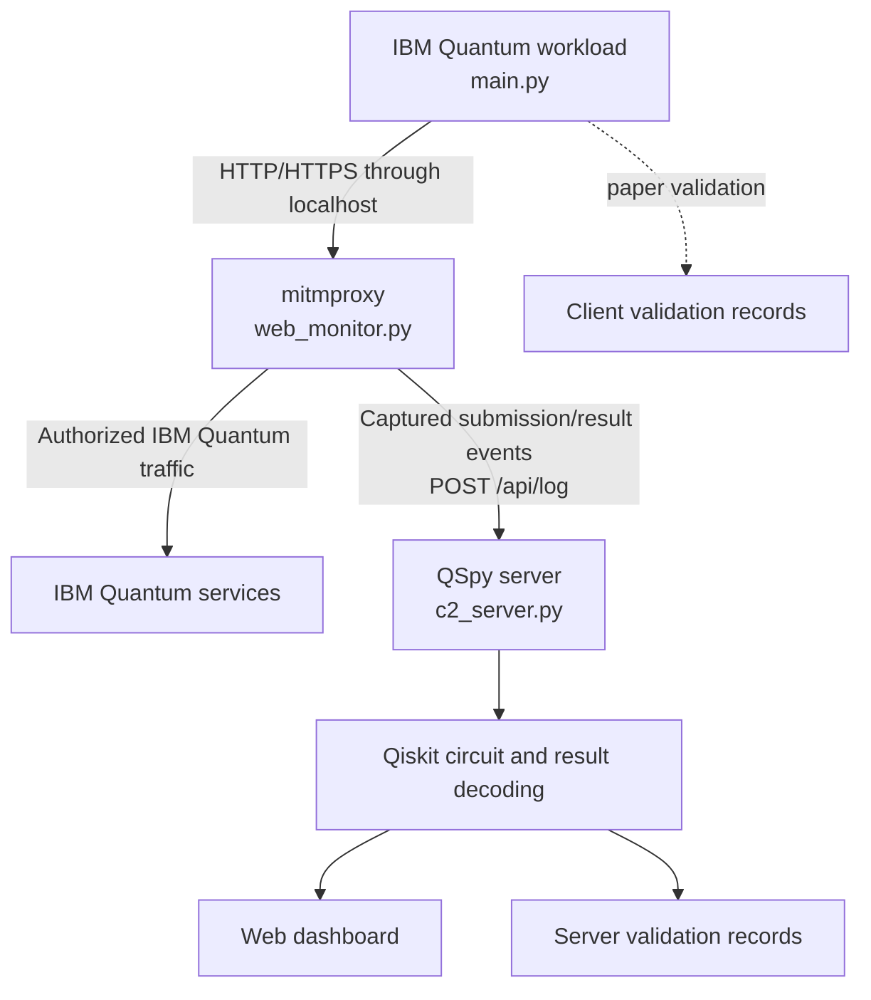

# QSpy

QSpy is a research prototype for observing IBM Quantum job submissions and
results at the network layer. It uses a mitmproxy addon on an authorized client
machine to identify relevant IBM Quantum traffic and forward captured event data
to a collection server. The server reconstructs submitted quantum circuits with
Qiskit, decodes returned measurement data, and presents recent activity through
a web dashboard.

The repository also includes a representative IBM Quantum workload and the
client/server validation records used for the associated research paper.

> **Authorized use only:** QSpy intercepts HTTPS traffic. Use it only on
> machines, accounts, and network traffic that you own or have explicit
> permission to inspect. Captured data can contain job identifiers, account
> information, circuit details, IP addresses, and measurement results.

## Components

QSpy has three runtime components:

1. **IBM Quantum workload** — `main.py` and `circuits.py` construct, transpile,
   and submit a quantum circuit through Qiskit IBM Runtime. These files represent
   what a normal IBM Quantum client might run.
2. **Monitoring client** — `client/start.bat` installs or locates mitmproxy,
   downloads the configured `web_monitor.py` addon, starts a local proxy, and
   opens a command prompt whose HTTP and HTTPS traffic uses that proxy.
3. **Collection server** — `server/c2_server.py` receives captured events,
   reconstructs circuits, decodes results, maintains in-memory activity state,
   writes research-validation records, and serves the dashboard.

The root and server directories are separate Python projects:

- Root `pyproject.toml` and `uv.lock` contain only dependencies needed by the
  normal IBM Quantum workload.
- `server/pyproject.toml` and `server/uv.lock` contain only dependencies needed
  by the collection server.
- The mitmproxy addon is executed on the monitored client, not by the server.
  `start.bat` installs mitmproxy and its addon dependencies on that client.

## End-to-end workflow



The sequence is:

1. The QSpy server starts on TCP port `8000`.
2. The server publishes the configured addon at `/static/web_monitor.py`.
3. An authorized Windows client runs `client/start.bat`.
4. The batch file downloads the addon and starts mitmproxy on local port `8080`
   by default.
5. The user runs the IBM Quantum workload from the command prompt opened by the
   batch file.
6. The addon observes matching IBM Quantum requests and responses and forwards
   capture events to the server's `/api/log` endpoint.
7. The server associates submissions and results using the IBM job ID, decodes
   their contents, and exposes the current state through its API and dashboard.
8. When paper validation code is enabled, client and server records can be
   compared by job ID and canonical circuit SHA-256 value.

## Repository layout

```text
qspy/
├── main.py                         # Representative IBM Quantum workload
├── circuits.py                     # Circuit construction helpers
├── pyproject.toml                  # Workload-client dependencies
├── uv.lock                         # Locked workload-client environment
├── .env.example                    # IBM Runtime configuration example
├── client/
│   ├── start.bat                   # Starts the monitored Windows session
│   └── stop.bat                    # Stops mitmproxy and clears proxy variables
├── server/
│   ├── c2_server.py                # Flask API, decoder, and dashboard server
│   ├── pyproject.toml              # Server dependencies
│   ├── uv.lock                     # Locked server environment
│   ├── requirements.txt            # Optional pip dependency list
│   ├── static/
│   │   └── web_monitor.py          # Addon downloaded by monitored clients
│   ├── templates/
│   │   └── quantum_dashboard.html  # Dashboard template
│   └── README.md                   # Standalone server deployment guide
└── validation_records/
    ├── client/                     # Paper ground-truth records
    └── server/                     # Records reconstructed by QSpy
```

## Prerequisites

### Workload and monitoring client

- Windows 10 or newer for the supplied batch scripts
- Python 3.11 or newer
- [uv](https://docs.astral.sh/uv/getting-started/installation/) for the locked
  workload environment
- An authorized IBM Quantum account and API token
- Network access to IBM Quantum and the QSpy server
- Permission to install and trust the local mitmproxy CA certificate

### Server

- Python 3.11 or newer
- uv, or pip when using `server/requirements.txt`
- Inbound TCP port `8000` available to authorized clients

## 1. Set up the server

The contents of `server/` are designed to be packaged and unpacked as a
standalone server project. On the deployed machine, the directory containing
`c2_server.py` is treated as the server project root.

Before deployment, edit `server/static/web_monitor.py` and replace:

```python
SERVER_PORT = "SERVER_PORT"
SERVER_IP = "SERVER_IP"
```

For example:

```python
SERVER_PORT = "8000"
SERVER_IP = "192.0.2.10"
```

Use a hostname when appropriate. For a public repository, avoid committing a
private deployment address; configure the copy included in the deployment
package instead.

Transfer and unpack the contents of `server/`, then install and run them from
the resulting directory:

```bash
uv sync --locked
uv run python c2_server.py
```

Alternatively, using pip:

```bash
python3 -m venv .venv
source .venv/bin/activate
python -m pip install -r requirements.txt
python c2_server.py
```

Verify the server before configuring a client:

```bash
curl http://127.0.0.1:8000/health
```

The server provides:

| URL | Purpose |
| --- | --- |
| `http://SERVER:8000/` | Web dashboard |
| `http://SERVER:8000/health` | Health check |
| `http://SERVER:8000/api/log` | Captured-event ingestion |
| `http://SERVER:8000/api/jobs` | Current decoded jobs and statistics |
| `http://SERVER:8000/api/activity` | Recent activity feed |
| `http://SERVER:8000/static/web_monitor.py` | Monitoring addon download |

For an internet-facing deployment, put the application behind an HTTPS reverse
proxy, restrict access, and avoid exposing the ingestion and dashboard routes
to untrusted networks. See [`server/README.md`](server/README.md) for the
standalone deployment guide and server-specific troubleshooting.

## 2. Set up the monitoring client

Open `client/start.bat` and replace its three placeholders:

```bat
SET "SCRIPT_URL=http://SERVER:8000/static/web_monitor.py"
SET "SCRIPT_NAME=web_monitor.py"
SET "MITMPROXY_PORT=8080"
```

- `SCRIPT_URL` must point to the configured addon served by the QSpy server.
- `SCRIPT_NAME` is the local filename used for the downloaded addon.
- `MITMPROXY_PORT` is the local proxy listener; change it if port `8080` is
  already occupied.

Run `start.bat` on the authorized Windows client. It will:

1. Confirm that `pip` is available.
2. Install mitmproxy if it is missing.
3. Download the monitoring addon from `SCRIPT_URL`.
4. Start mitmproxy in a separate window.
5. Open a new command prompt with `HTTP_PROXY`, `HTTPS_PROXY`,
   `REQUESTS_CA_BUNDLE`, and `SSL_CERT_FILE` configured for the local proxy.

The mitmproxy CA certificate is normally created under
`%USERPROFILE%\.mitmproxy\`. It must be trusted by the authorized test client
for HTTPS interception to work. Do not distribute or publish private CA keys.

Run workloads only from the configured command prompt. When finished, run
`client/stop.bat` to stop mitmproxy and clear the proxy variables.

## 3. Set up and run the IBM Quantum workload

From the repository root, install the locked workload dependencies:

```bash
uv sync --locked
```

Create a local `.env` file containing the variables read by `main.py`:

```dotenv
API_TOKEN=your-ibm-quantum-api-token
QISKIT_INSTANCE_NAME=your-instance-or-service-instance
```

`QISKIT_INSTANCE_NAME` may be omitted when it is not required by the selected
IBM Quantum account configuration.

Select the circuit in `main.py`. The repository includes helpers in
`circuits.py` for Bell, GHZ, Grover, QFT, parameterized ansatz, and random
circuits. The selected circuit is measured, transpiled for an available IBM
backend, submitted through `SamplerV2`, and its result counts are printed.

From the command prompt opened by `client/start.bat`, change to the repository
root and run:

```bat
uv run python main.py
```

Running the workload outside that configured prompt bypasses the proxy unless
equivalent proxy variables are set by another authorized mechanism.

## Research validation records

`validation_records/` contains paired artifacts retained for paper review:

- `validation_records/client/` contains client-side ground truth from the
  circuit immediately submitted to IBM Quantum and its returned measurements.
- `validation_records/server/` contains the corresponding circuit and result
  information independently reconstructed from captured traffic.
- Records are joined using the IBM job ID. Canonical circuit SHA-256 values
  provide a deterministic structural comparison between the submitted and
  reconstructed Qiskit circuits.

The paper-only code in `main.py` is enclosed by explicit markers:

```python
# --- Validation starts --- #
# Paper validation logic
# --- Validation ends --- #
```

Keep those blocks when reproducing the paper validation. A normal workload
client that does not need to generate validation artifacts can remove or comment
out all marked blocks without changing circuit construction, submission, or
result retrieval.

The server writes validation records to `validation_records/` relative to its
working directory by default. Set `QSPY_VALIDATION_DIR` to choose another
location:

```bash
QSPY_VALIDATION_DIR=/var/lib/qspy/validation_records uv run python c2_server.py
```

Review and anonymize newly generated records before publishing them. They may
contain IBM job IDs, backend names, client IP addresses, timestamps, circuit
metadata, and measurement results.

## Troubleshooting

- **`uv sync --locked` reports a stale lockfile:** Run it from the correct
  project root. The workload uses the root lock; the server uses `server/uv.lock`.
- **The dashboard returns `TemplateNotFound`:** Confirm that
  `templates/quantum_dashboard.html` is next to the deployed server's
  `c2_server.py` under the `templates/` directory.
- **The addon download returns 404:** Confirm that `static/web_monitor.py`
  exists in the server deployment and open its URL directly from the client.
- **The addon cannot reach QSpy:** Check `/health`, TCP port `8000`, firewall or
  reverse-proxy rules, and the `SERVER_IP` and `SERVER_PORT` values embedded in
  the deployed addon.
- **No IBM Quantum traffic is captured:** Run the workload from the command
  prompt opened by `start.bat`, verify the proxy variables, and confirm that the
  mitmproxy CA is trusted.
- **Mitmproxy does not start:** Ensure its configured local port is free and
  that `mitmproxy` is available on `PATH`.
- **IBM authentication fails:** Confirm `API_TOKEN`, check whether
  `QISKIT_INSTANCE_NAME` is required, and ensure the `.env` file is in the
  workload project root.
- **Client and server validation records do not pair:** Verify that both sides
  captured the same IBM job ID and that the server validation output directory
  is the one being inspected.

## Security and data-handling notes

- Do not run QSpy on third-party traffic without explicit authorization.
- Do not commit `.env`, API tokens, captured mitmproxy flows, private
  certificates, or unreviewed runtime records.
- Treat the dashboard and APIs as sensitive; the prototype does not implement
  authentication or persistent access control.
- Use network restrictions and an authenticated HTTPS reverse proxy for any
  deployment beyond an isolated research environment.
- Stop the proxy and remove temporary downloaded artifacts when an experiment
  is complete.
